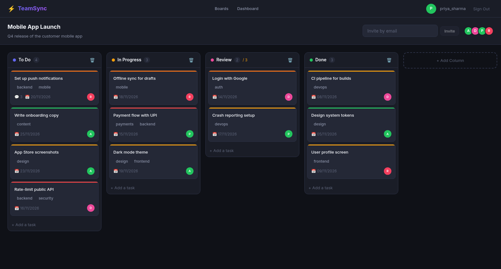
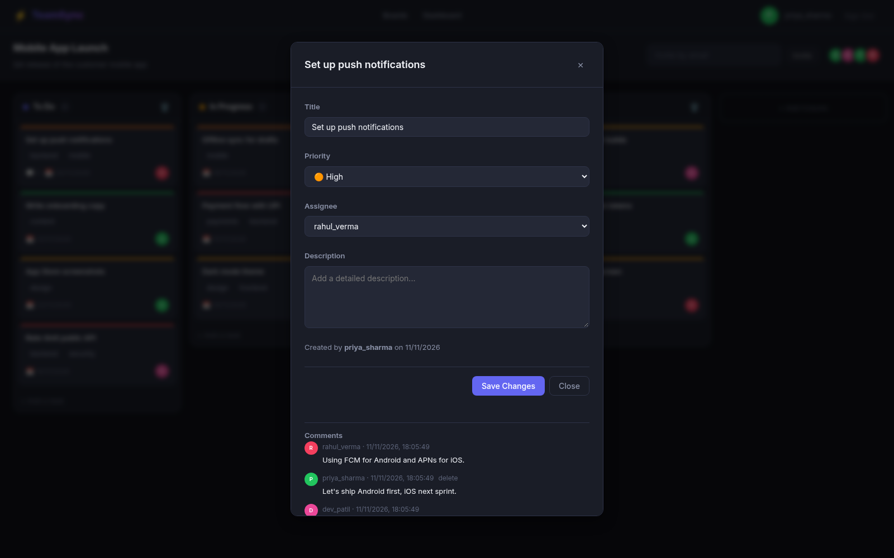
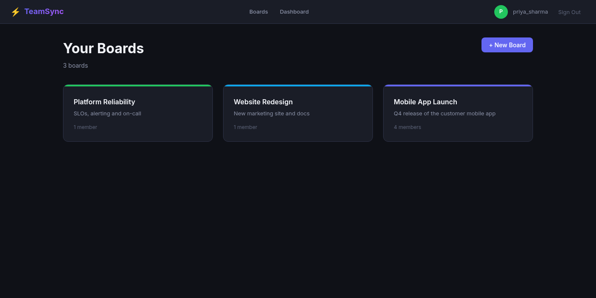
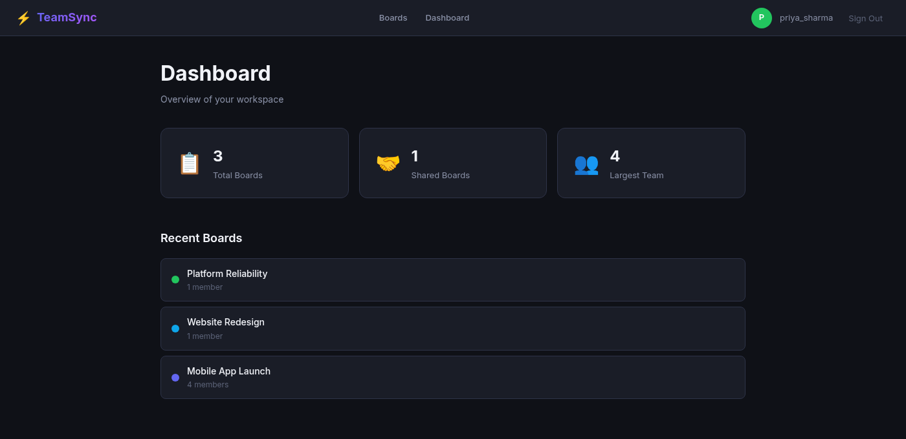

# ⚡ TeamSync — Real-Time Collaborative Project Management

[](https://github.com/pruthvi300/teamsync/actions/workflows/ci.yml)

> Drag-and-drop Kanban boards with real-time collaboration, built with React 18 and FastAPI.

[](https://react.dev)
[](https://fastapi.tiangolo.com)
[](https://postgresql.org)
[](https://socket.io)
[](https://docker.com)


---

## 📸 Screenshots

**Kanban board**: columns with WIP limits, priorities, labels, due dates and assignees; drag cards between columns and every member sees the change live



**Task details**: edit priority and assignee, and discuss in comments



**Boards and dashboard**

| Your boards | Dashboard |
|-------------|-----------|
|  |  |

---

## ✨ Features

- 📋 **Kanban Boards** — Create boards with customizable columns (To Do, In Progress, Done)
- 🖱️ **Drag-and-Drop** — Move tasks between columns with smooth animations (@dnd-kit)
- 👥 **Real-Time Collaboration** — See changes from other users instantly via WebSocket
- 🔐 **JWT Authentication** — Secure login/register with access + refresh tokens
- 📊 **Dashboard** — Overview statistics across all boards
- 🎯 **Task Management** — Priority levels, labels, due dates, descriptions, comments
- 🎨 **Beautiful Dark UI** — Modern design with CSS custom properties design system
- ⚡ **Optimistic Updates** — UI responds instantly, syncs with server in background

---

## 🏗️ Tech Stack

| Layer | Technology | Purpose |
|-------|-----------|---------|
| **Frontend** | React 18 + Vite | SPA with modern React (hooks, memo, lazy) |
| **State** | Zustand | Global state management (auth + board) |
| **Drag & Drop** | @dnd-kit | Accessible drag-and-drop for task cards |
| **Real-Time** | Socket.IO Client | WebSocket for live board updates |
| **Routing** | React Router v6 | Protected routes, lazy loading, nested layouts |
| **Animations** | Framer Motion | Smooth page transitions and card animations |
| **Styling** | CSS Modules + Custom Properties | Scoped styles with design tokens |
| **Backend** | FastAPI + Uvicorn | Async REST API + WebSocket server |
| **Database** | PostgreSQL + SQLAlchemy Async | Relational data with connection pooling |
| **Auth** | PyJWT + Bcrypt | JWT tokens + password hashing |
| **WebSocket** | python-socketio | Real-time event broadcasting with rooms |
| **DevOps** | Docker Compose | One-command development environment |

---

## 🚀 Quick Start

### Option 1: Docker Compose (Recommended)

```bash
git clone https://github.com/pruthvi300/teamsync.git
cd teamsync
cp .env.example .env
docker compose up --build
```

**Access:**
- 🌐 Frontend: http://localhost:5173
- 📡 API: http://localhost:8000
- 📖 Swagger Docs: http://localhost:8000/docs

### Option 2: Local Development

Requires Python 3.11+, Node.js 20+, and PostgreSQL and Redis running locally (or start just those two with `docker compose up -d postgres redis`).

```bash
# Terminal 1: Backend
cd api
python -m venv venv
source venv/bin/activate
pip install -r requirements.txt
cp ../.env.example .env   # set DATABASE_URL and REDIS_URL to use localhost instead of postgres / redis
uvicorn app.main:app --reload --port 8000

# Terminal 2: Frontend
cd frontend
npm install
npm run dev
```

---

## 📁 Project Structure

```
teamsync/
├── api/                              # FastAPI Backend
│   ├── app/
│   │   ├── main.py                   # App entry point (CORS, routes, Socket.IO)
│   │   ├── core/
│   │   │   ├── config.py             # Pydantic Settings (env vars)
│   │   │   ├── database.py           # Async SQLAlchemy engine + session
│   │   │   ├── security.py           # JWT + Bcrypt helpers
│   │   │   └── dependencies.py       # FastAPI dependency injection (auth)
│   │   ├── models/                   # SQLAlchemy ORM models
│   │   │   ├── user.py               # User (UUID, bcrypt, soft delete)
│   │   │   ├── board.py              # Board + board_members junction
│   │   │   ├── column.py             # Column (position, WIP limit)
│   │   │   ├── task.py               # Task (priority, labels, assignee)
│   │   │   └── comment.py            # Comment (threaded discussions)
│   │   ├── schemas/                  # Pydantic request/response schemas
│   │   │   ├── user.py               # UserCreate, UserResponse, TokenResponse
│   │   │   └── board.py              # Board, Column, Task, Comment schemas
│   │   ├── api/                      # Route handlers
│   │   │   ├── auth.py               # Register, Login, Refresh, Me
│   │   │   ├── boards.py             # Board CRUD + member management
│   │   │   ├── columns.py            # Column CRUD + reorder
│   │   │   ├── tasks.py              # Task CRUD + drag-and-drop move
│   │   │   └── comments.py           # Comment CRUD
│   │   └── services/
│   │       └── websocket.py          # Socket.IO server (rooms, broadcast)
│   ├── requirements.txt
│   └── Dockerfile
├── frontend/                         # React 18 Frontend
│   ├── src/
│   │   ├── main.jsx                  # React entry point (StrictMode)
│   │   ├── App.jsx                   # Routes, lazy loading, protected routes
│   │   ├── index.css                 # Design system (CSS custom properties)
│   │   ├── store/
│   │   │   ├── authStore.js          # Zustand auth (login, register, logout)
│   │   │   └── boardStore.js         # Zustand board (CRUD, optimistic updates)
│   │   ├── hooks/
│   │   │   └── useWebSocket.js       # Authenticated Socket.IO connection + live updates
│   │   ├── services/
│   │   │   └── api.js                # Axios instance + interceptors + API functions
│   │   ├── components/
│   │   │   ├── common/Common.jsx     # Button, Input, Modal, Avatar, Badge, ErrorBoundary
│   │   │   ├── auth/ProtectedRoute.jsx
│   │   │   └── layout/              # Layout, Navbar
│   │   └── pages/
│   │       ├── LoginPage.jsx
│   │       ├── RegisterPage.jsx
│   │       ├── BoardsPage.jsx        # Board list with create modal
│   │       ├── BoardDetailPage.jsx   # ⭐ THE Kanban board (DnD, memo, sortable)
│   │       └── DashboardPage.jsx     # Analytics overview
│   ├── package.json
│   ├── vite.config.js
│   └── Dockerfile
├── docker-compose.yml
├── Makefile
├── .env.example
└── README.md
```

---

## 🔑 React Patterns Used

| Concept | Where It's Used | File |
|---------|----------------|------|
| **Custom Hooks** | `useWebSocket` | `hooks/` |
| **Zustand State** | Auth store, Board store (optimistic updates, snapshot/rollback) | `store/` |
| **React.memo** | `KanbanColumn`, `SortableTaskCard`, `TaskCardUI` — prevent re-renders | `BoardDetailPage.jsx` |
| **useMemo** | Memoize task IDs for SortableContext, dashboard stats | `BoardDetailPage.jsx` |
| **useCallback** | Memoize drag handlers, add task/column handlers | `BoardDetailPage.jsx` |
| **useEffect cleanup** | Disconnect WebSocket, clear board state | `useWebSocket.js` |
| **React.lazy + Suspense** | Code-split pages (login, board, dashboard) | `App.jsx` |
| **Error Boundaries** | Catch rendering errors without crashing app | `Common.jsx` |
| **Portals** | Modal renders at document.body (z-index safe) | `Common.jsx` |
| **forwardRef** | Custom Input compatible with form libraries | `Common.jsx` |
| **Controlled Components** | Login/Register forms with useState | `LoginPage.jsx` |
| **Protected Routes** | Auth guard with Outlet + Navigate | `ProtectedRoute.jsx` |
| **Framer Motion** | Page transitions, card hover effects, staggered lists | Throughout |
| **CSS Modules** | Scoped styles per component (no global conflicts) | `*.module.css` |

---

## 🧪 Testing

```bash
cd api
pip install -r requirements-dev.txt
pytest          # 21 tests: auth, membership/authorization, task ordering, WIP limits, live Socket.IO
ruff check app tests
```

## 🔒 Security notes

- Every board, column, task and comment endpoint checks board membership; only the owner can rename, delete or invite.
- Socket.IO connections must present an access token, and `join_board` checks membership.
- The refresh token is stored in `localStorage` so sessions survive a reload. An httpOnly cookie would be safer against XSS.

---

## 📝 License

[MIT](LICENSE)

---

## 👨‍💻 Author

**Pruthviraj Kakade** — Full Stack Developer
- GitHub: [github.com/pruthvi300](https://github.com/pruthvi300)
- LinkedIn: [linkedin.com/in/pruthviraj-kakade-631742169](https://linkedin.com/in/pruthviraj-kakade-631742169)
